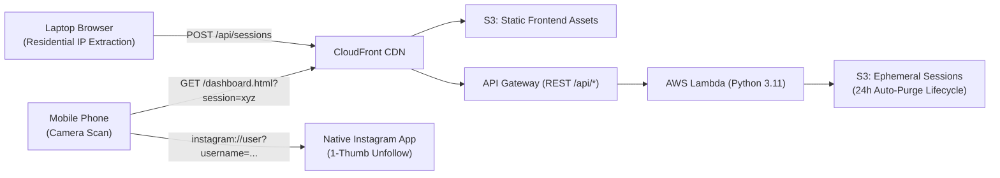

# InstaExtract ⚡

> Advanced Instagram follower analytics, relationship auditing, and safe unfollow management.
> Live Web Platform: [**https://instaextract.in**](https://instaextract.in) (and [**https://www.instaextract.in**](https://www.instaextract.in))
> Run locally with the high-performance C++ engine, or deploy globally on AWS Serverless with CloudFront, S3, API Gateway, Lambda, and Method B Mobile QR Hand-off.

---

## 🌟 Key Capabilities

- **Relational Breakdown**:
  - 🚫 **Don't Follow Back** (Prime unfollow targets)
  - ⭐ **Fans** (Follow you, but you don't follow back)
  - 🤝 **Mutual Friends** (Both follow each other)
  - 📥 **All Followers** & 📤 **All Following**
- **Method B Mobile QR Hand-off**:
  - Run residential client extraction on your laptop (safe from AWS datacenter bot blocks).
  - Click **"📱 Scan to Review on Mobile"** to generate an ephemeral cloud session (purged in 24h via S3 lifecycle).
  - Scan the QR code on your phone to open the dashboard — tapping **"Open ↗"** on any profile deep-links directly into the native Instagram app (`instagram://user?username=...`) for instant 1-thumb unfollowing!
- **100% In-Browser Automation**:
  - Generates safe, human-paced in-browser unfollow scripts with Start/Pause controls and random jitter (30s–45s).
- **Dual Architecture**:
  - **Modern Web Application**: Static frontend on CloudFront + S3, ephemeral session sync on AWS Lambda + S3.
  - **Native C++ Engine**: High-throughput terminal analyzer with multi-threaded pagination and responsive HTML report generation.

---

## ☁️ Architecture & AWS CDK Deployment

Detailed architecture, security model, and cost analysis are documented in [docs/DESIGN.md](docs/DESIGN.md).



### Deploying to AWS via CDK

```bash
# 1. Login to AWS SSO or configure AWS credentials
aws sso login --profile pushp-sde-aws

# 2. Install dependencies & synthesize CloudFormation
cd cdk
npm install
npx cdk synth --profile pushp-sde-aws

# 3. Deploy Stack
npx cdk deploy --require-approval never --profile pushp-sde-aws
```

---

## 💻 Local C++ Engine Usage

### Prerequisites
- CMake 3.10+
- C++17 compatible compiler (Clang or GCC)
- libcurl & OpenSSL

### Build & Run
```bash
# 1. Compile project
cmake -B build
cmake --build build

# 2. Extract cURL commands from Instagram Web DevTools Network tab:
#    - Save Followers query to config/curlRequestFollowers.txt
#    - Save Following query to config/curlRequestFollowing.txt

# 3. Run analyzer
./build/main

# 4. Open interactive dashboard
open profiles.html
```

---

## 🛡️ Security & Privacy

1. **Zero Password Storage**: Uses user's existing authentic session tokens (cURL or Bookmarklet).
2. **Ephemeral Sessions**: Data uploaded for mobile scanning is stored in private S3 buckets and automatically deleted within 24 hours via S3 lifecycle rules.
3. **No Datacenter Bot Risk**: All scraping requests originate directly from the user's authentic browser session on their home residential IP.

---

## 📄 License
MIT License.
