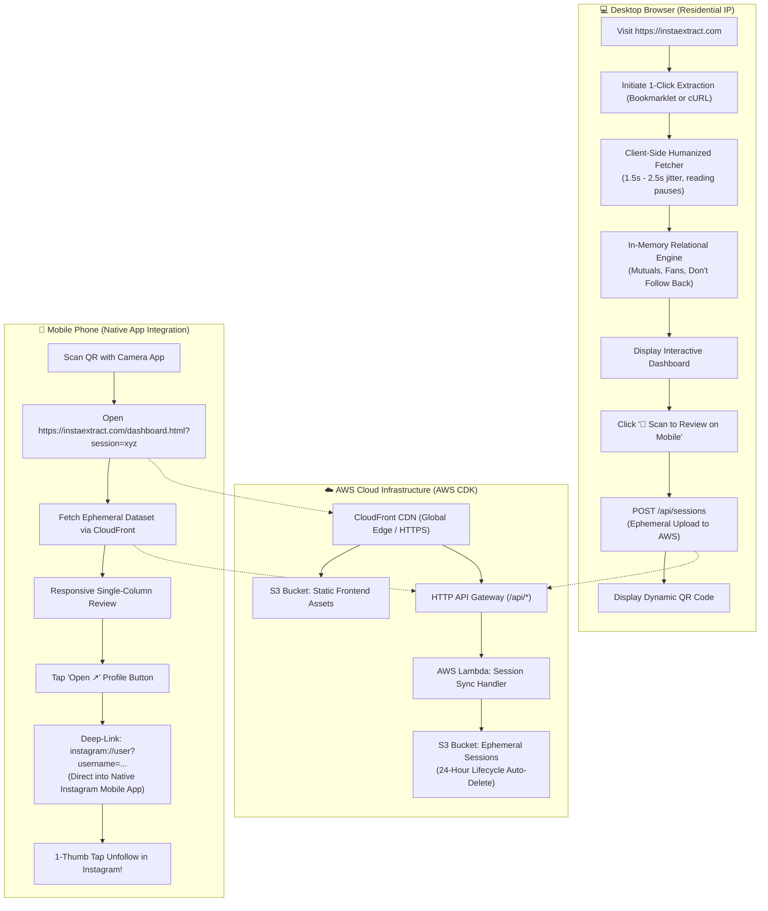
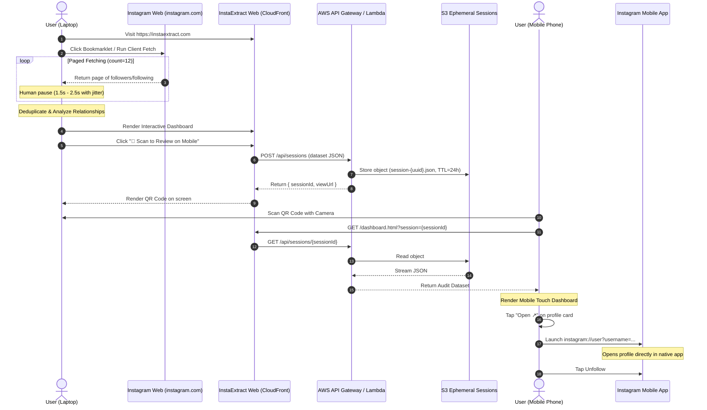

# InstaExtract: System Architecture & Design Document

## 1. Overview & Problem Statement

**InstaExtract** is an Instagram relational audit and follower analysis platform designed to identify non-mutual followers ("people who don't follow back"), fans ("people who follow you whom you don't follow"), and mutual friends.

### Core Challenges & Constraints
1. **Anti-Bot Detection & Account Safety**:
   - Meta's edge security strictly monitors request patterns, IP classifications, and authentication headers.
   - Requests originating from cloud datacenter IP ranges (AWS EC2, Lambda, GCP, DigitalOcean) are flagged with HTTP 429 rate limits, `feedback_required`, or `checkpoint_required` security locks.
2. **Developer Experience vs. Everyday User Experience**:
   - Traditional extraction methods require terminal environments, C++ compilation, and manual DevTools cURL copying.
   - Non-technical users require a seamless, zero-code, one-click experience on desktop, coupled with an effortless unfollowing experience on mobile.
3. **Mobile Browser Limitations**:
   - Mobile Safari and Chrome lack Network inspection tools to extract session details.
   - Manual data downloads from Meta's Accounts Center require multiple days of asynchronous waiting.

---

## 2. Architecture & The "Method B" Hand-off Model

To solve both anti-bot detection and mobile usability, InstaExtract employs **Method B: Desktop Client-Side Extraction with Mobile QR Hand-off**:



---

## 3. Sequence Diagram: End-to-End Data Flow



---

## 4. Mobile Deep-Linking Protocol

Mobile operating systems handle URL schemes natively:
- **iOS & Android Scheme**: `instagram://user?username={username}`
- **Web Fallback**: `https://www.instagram.com/{username}/`

### Implementation Logic in `app.js`:
```javascript
function openProfile(username) {
  const isMobile = /Android|iPhone|iPad|iPod/i.test(navigator.userAgent);
  if (isMobile) {
    const nativeUri = `instagram://user?username=${username}`;
    const webUri = `https://www.instagram.com/${username}/`;
    
    // Attempt deep-link into native Instagram app
    const start = Date.now();
    window.location.href = nativeUri;
    
    // Fallback to web browser tab if native app is not installed
    setTimeout(() => {
      if (Date.now() - start < 1500) {
        window.open(webUri, '_blank');
      }
    }, 800);
  } else {
    window.open(`https://www.instagram.com/${username}/`, '_blank');
  }
}
```

---

## 5. Security, Privacy & Zero-Knowledge Model

1. **No Password Storage**:
   - InstaExtract never requests, stores, or handles user passwords.
   - Authentication is maintained solely inside the user's authentic browser session.
2. **Ephemeral Cloud Storage (24-Hour TTL)**:
   - When a dataset is synced for QR hand-off, it is stored in `instaextract-sessions-bucket`.
   - An AWS S3 **Lifecycle Configuration Rule** automatically permanently deletes all objects 1 day (24 hours) after creation.
3. **Payload Encryption & Sanitization**:
   - Only public relationship metadata is stored (`pk`, `username`, `fullName`, `isPrivate`, `isVerified`, `relationship`).
   - Session identifiers are cryptographically random UUIDv4 keys.
4. **Zero Cloud Datacenter Bot Triggers**:
   - Instagram queries are **never** executed by AWS compute instances.
   - All network traffic to `api.instagram.com` originates from the user's personal residential IP address.

---

## 6. AWS CDK Infrastructure Specification

The infrastructure is strictly managed as code using **AWS CDK (TypeScript)**:

```
cdk/
├── bin/
│   └── instaextract-app.ts       # CDK App entrypoint & environment injection
├── lib/
│   └── instaextract-stack.ts     # Complete single-stack infrastructure definition
├── package.json                  # Dependencies: aws-cdk-lib, constructs
├── tsconfig.json                 # TypeScript compiler configuration
└── cdk.json                      # CDK CLI context & execution options
```

### Managed AWS Resources:
1. **`s3.Bucket` (Frontend)**:
   - Private bucket hosting static HTML, CSS, JS, and vendor assets.
   - Block public access enabled; origin access restricted via CloudFront Origin Access Control (OAC).
2. **`s3deploy.BucketDeployment`**:
   - Automatically synchronizes local `web/` assets to the frontend S3 bucket during deployment.
3. **`s3.Bucket` (Ephemeral Sessions)**:
   - Encrypted via S3-Managed KMS (`AES256`).
   - Lifecycle rule: `Expiration: Duration.days(1)`.
4. **`lambda.Function` (Session Sync Handler)**:
   - Python 3.12 runtime with minimal memory footprint (256MB).
   - Principle of Least Privilege IAM policy allowing `s3:PutObject` and `s3:GetObject` on the sessions bucket only.
5. **`apigateway.HttpApi`**:
   - Low-latency, cost-effective HTTP API Gateway.
   - CORS enabled for the CloudFront domain.
6. **`cloudfront.Distribution`**:
   - Origin 1: S3 Frontend Bucket (Default behavior `/*`).
   - Origin 2: HTTP API Gateway (Behavior `/api/*`).
   - HTTPS enforced (`ViewerProtocolPolicy.REDIRECT_TO_HTTPS`).
   - HTTP/2 & HTTP/3 enabled, gzip/brotli compression.

---

## 7. CI/CD Best Practices (GitHub Actions)

### Pipeline Architecture:
```
[Git Push to master/main]
        │
        ▼
   [Job 1: Lint & Validate]
   • TypeScript type-check (`npm run build`)
   • Python syntax check (`flake8`)
   • CDK Synth test (`cdk synth --dry-run`)
        │
        ▼
   [Job 2: AWS OIDC Authentication]
   • Assume AWS IAM Role via OpenID Connect (OIDC)
   • ❌ No long-lived AWS Access Keys stored in GitHub Secrets
        │
        ▼
   [Job 3: Automated CDK Deploy]
   • `cdk deploy --require-approval never`
   • Automated CloudFront Cache Invalidation
```

### Security Benefits of GitHub Actions OIDC:
- Eliminates hardcoded `AWS_ACCESS_KEY_ID` and `AWS_SECRET_ACCESS_KEY`.
- Temporary credentials rotate automatically per workflow run with short-lived STS tokens.
- Restricts deployment permissions strictly to repository branch `refs/heads/master`.

---

## 8. Cost & Operational Analysis

| Component | Usage Tier | Estimated Monthly Cost |
| :--- | :--- | :--- |
| **AWS CloudFront** | 1 TB/month transfer out (Free Tier) | **$0.00** |
| **AWS S3 (Frontend)** | < 50 MB static assets | **$0.00** |
| **AWS S3 (Sessions)** | 24-hr ephemeral files (< 500 MB) | **$0.01** |
| **AWS Lambda** | 1,000,000 free requests/month | **$0.00** |
| **AWS API Gateway** | 1,000,000 free calls/month | **$0.00** |
| **Total Estimated Cost**| **Entirely within AWS Free Tier** | **~$0.01 / month** |


---

## 9. Live AWS Deployment Details

The infrastructure is synthesized and deployed strictly using AWS CDK into account `851725215059` (**Mumbai region `ap-south-1`**):

- **Primary Custom Domain**: [**`https://instaextract.in`**](https://instaextract.in) (and [**`https://www.instaextract.in`**](https://www.instaextract.in))
- **Live CloudFront Web Platform**: [`https://d2lzmca6g93nkq.cloudfront.net`](https://d2lzmca6g93nkq.cloudfront.net)
- **API Gateway Live Endpoint**: `https://gigev4g5l0.execute-api.ap-south-1.amazonaws.com/prod/`
- **Frontend S3 Bucket**: `instaextractstack-frontendbucketefe2e19c-q33whra9xsmz` (`ap-south-1`)
- **Ephemeral Sessions S3 Bucket**: `instaextractstack-sessionsbucketb3d7a028-pgdzmjjwzzxw` (`ap-south-1` with 24-hour auto-purge lifecycle)
- **ACM SSL Certificate**: `arn:aws:acm:us-east-1:851725215059:certificate/1bdce065-665e-49d5-8cfe-11279eb16b61` (`instaextract.in`, `www.instaextract.in`)
- **Route 53 DNS**: Hosted Zone `Z00234906NHV6M71LO1M` (`instaextract.in`) with IPv4 (A) and IPv6 (AAAA) CloudFront Alias records.
- **CloudFormation Stack ARN**: `arn:aws:cloudformation:ap-south-1:851725215059:stack/InstaextractStack/66e82300-dfb5-11f1-829c-06ffdeb798d1`
- **CI/CD Workflow**: [`.github/workflows/deploy.yml`](../.github/workflows/deploy.yml) (Automated GitHub Actions pipeline with AWS OIDC, Python/Node linting, CDK synth, and CDK deploy).

---

## 10. Safari & Content Security Policy (CSP) In-Browser Extraction Engine

### The Problem with Traditional Bookmarklets
Instagram enforces an aggressive `Content-Security-Policy` header:
```http
script-src 'self' 'unsafe-inline' https://*.cdninstagram.com ...
```
When traditional bookmarklets attempt to inject an external script tag:
```javascript
const s = document.createElement('script');
s.src = 'https://instaextract.in/app.js';
document.body.appendChild(s);
```
The browser's CSP engine immediately and silently blocks the external network request, throwing a security violation. Furthermore, modern macOS Safari restricts users from dragging multi-line `javascript:` URLs to the bookmarks bar.

### The Solution: Standalone Self-Contained Auditor (`auditor.js`)
InstaExtract solves this with a **zero-dependency in-browser audit engine**:
1. **1-Click Console Execution**:
   - The user clicks **"📋 Copy 1-Click Extraction Script"** on `https://instaextract.in`.
   - In their active Instagram tab, they open Developer Console (<kbd>Cmd + Option + C</kbd> on Safari or <kbd>Cmd + Option + J</kbd> on Chrome) and paste.
2. **Floating HUD Interface**:
   - Injects a high-z-index, glassmorphic floating control panel in the bottom-right corner of Instagram.
   - Automatically extracts `csrftoken` and user ID (`ds_user_id` / `/api/v1/accounts/current_user/`).
   - Fetches followers and following lists with randomized human residential delays (1.2s - 2.2s jitter).
   - Dynamically analyzes relationships (Mutuals, Fans, Don't Follow Back).
3. **Cross-Origin Data Transfer via `window.name` & `postMessage`**:
   - Once extraction is complete, the engine launches `https://instaextract.in/dashboard.html`.
   - Data is transferred across origins via `window.name = JSON.stringify(dataset)`.
   - `window.name` is cross-origin writable and 100% immune to Content Security Policy, CORS, and network firewalls.
   - The dashboard parses `window.name` on mount, persists to `sessionStorage`, and renders the candidate cards instantly!
